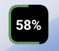
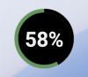
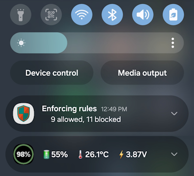

# 98%

98% is an Android battery home-screen widget with customizable appearance and optional notification.

Users can configure the widget's

- Select the background and text colors.
- Adjust the border width and color.
- Choose between a rounded square and a circular shape.

ᅠᅠᅠᅠᅠᅠ

An optional persistent notification can also be enabled through the app's configuration activity, displaying battery percentage, temperature, and voltage.

## Building

1. Clone or download this repository.
2. Open the project in Android Studio.
3. Allow Gradle to sync and download the required dependencies.
4. Select the `release` build variant.
5. Build the APK using **Build → Generate App Bundles or APKs → Build APK(s)**, or the Gradle `assembleRelease` task.

A release build requires your own signing configuration.

## Installation

Prebuilt APKs are available in Releases tab.

The release APKs are signed, but are distributed outside Google Play. Installation therefore requires sideloading:

1. Download the APK to your Android device.
2. Allow your browser or file manager to install unknown apps when prompted.
3. Open the APK and follow the installation instructions.

Android may display a security warning because the app was obtained outside Google Play.

## License

This project is licensed under the MIT License. See [LICENSE](LICENSE) for details.